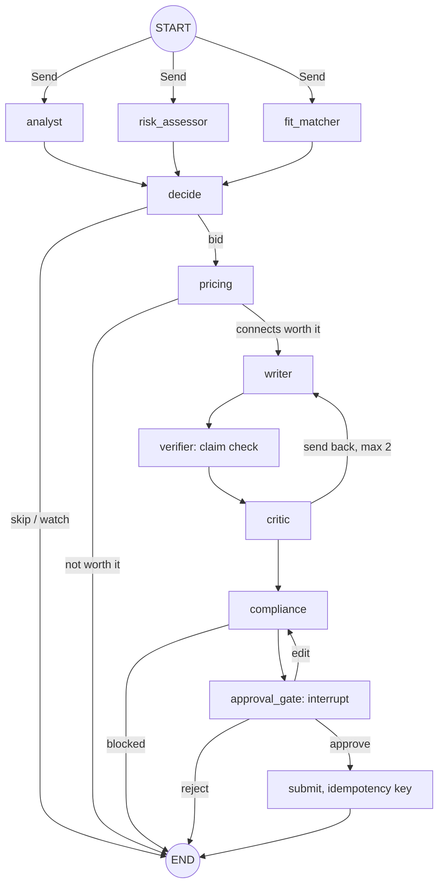

# Architecture

```
 React (Vite, TS) ──typed client (openapi-typescript)──> FastAPI /api ──SSE──> browser
                                                            │
                         ┌──────────── Runtime (apps/api/service.py) ─────────────┐
                         │  bid graph + conversation graph (LangGraph)            │
                         │  AsyncSqliteSaver checkpointer · LangGraph SqliteStore │
                         │  ToolHub: MCP sessions + per-agent tool allowlists     │
                         └───────┬───────────────┬─────────────────┬──────────────┘
                                 │ MCP           │ MCP             │ MCP
                     Portfolio server   Marketplace server   Workspace server
                     (read-only RAG)    (port → adapter)     (calendar/email mock)
                                              │
                          ┌───────────────────┴───────────────┐
                    GigSimAdapter (REST)            UpworkLiveAdapter (official Upwork MCP,
                    → GigSim simulator              OAuth 2.1, drafts only)
 Worker (Arq/Redis): scheduled scouting + analyze_job, same Runtime.
```

## Bid graph (one thread per job) — `agent/graphs/bid_graph.py`


Rendered from code: `docs/images/bid_graph.mmd` (`graph.get_graph().draw_mermaid()`).
Conversation graph: `load_thread → liaison (intent + reply) → slots → compliance → approval
[interrupt] → send` (`agent/graphs/conversation_graph.py`).

## Why each agent exists

| Agent | Why it is a separate node | Model? |
|---|---|---|
| Job Analyst | Turns untrusted free text into a typed `JobSpec` (requirements, screening questions) that later steps decide on; has **no tools**, so injected text cannot trigger a tool call. | LLM (small) |
| Risk Assessor | Scam/injection screening must run on every job and cheaply; deterministic regex signals are a floor the LLM cannot lower. | LLM + rules |
| Fit Matcher | Requirement→evidence mapping is retrieval-heavy and independent of the analyst, so it runs **in parallel**. | LLM + RAG |
| decide | A rule (thresholds in config), not an LLM: auditable and free. | rules |
| Pricing Strategist | Market statistics from 53k real posts + persona floor; deterministic so prices are explainable. | rules |
| Proposal Writer | The only creative step; gets evidence ids and must list every claim with them. | LLM (best) |
| Verifier (claim check) | One batched call labels each claim; unsupported ones are deleted before the Critic sees the draft. | LLM |
| Critic | Separate judge of personalisation/grounding/length; bounded loop (≤2). | LLM |
| Compliance Guard | Policy pack enforcement; regex redaction first, LLM second; re-runs after human edits. | rules + LLM |
| Client Liaison | Conversation graph: intent, reply, interview slots via Workspace MCP. | LLM |

Merged/split relative to the brief: *Scout* is the worker's `scout_saved_searches` task plus
the `search_jobs` tool (no LLM needed for de-dup), and claim verification is its own node.

## State, trace and memory are kept apart

* **State** (`agent/state.py`, `BidState`): only what this job needs now. Parallel branches write
  distinct keys; accumulators (`trace`, `usage`, `steps`, `critiques`, `errors`) use reducers.
* **Execution trace**: `trace` entries per node + the Marketplace server's append-only audit log
  (user, tool, PII-masked args, result, trace id = thread id) + the LLM cost ledger.
* **Long-term memory** (`agent/memory/`): LangGraph store namespaces `style` and `outcome`,
  written **only** by `promotion_rules.py` (style rule after ≥2 distinct edits; category outcome
  stats after ≥3 known outcomes). Raw tool output never reaches memory.

## Human in the loop, durability, failure handling
* `interrupt()` in `approval_gate` before any submit; payload carries draft, evidence per claim,
  verification, risk, price rationale, critiques, compliance and the `dry_run` preview.
* Submit runs in its **own node after** the interrupt with idempotency key
  `thread_id:sha256(payload)` → a resumed/re-run submit replays instead of double-spending
  (tested across two OS processes: `tests/integration/test_bid_graph.py`).
* `safe()` wrapper per node: marketplace failure → `degraded_queued` (UI banner, re-queued on
  recovery), budget → `needs_attention`, other errors → `dead_letter`; LLM calls have bounded
  retries/backoff and an optional fallback model.
